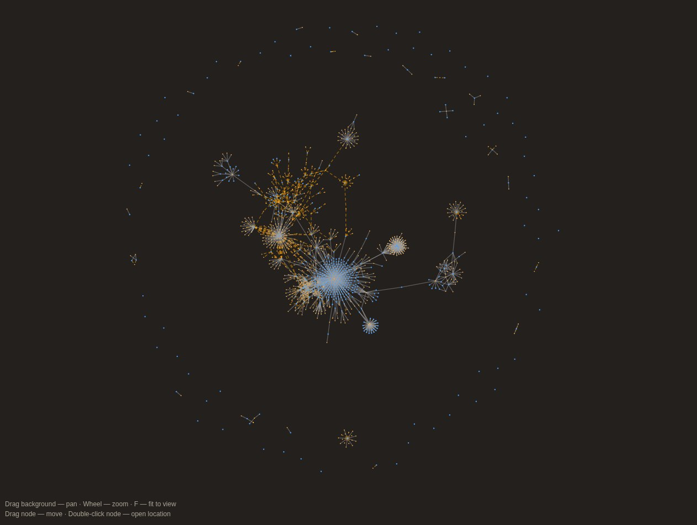

# Rust Use Graph

_libc.rs graph_


A Visual Studio Code extension that builds and visualizes a **file dependency graph for Rust projects** based on `use` and `mod` declarations found in `.rs` source files.

> Open the command palette and run **"Rust: Show use/mod Graph"** to render an interactive graph of how your Rust files and modules reference one another.

---

## Features

- **Automatic scanning** of every `.rs` file in the workspace (excluding `target/`) plus every `Cargo.toml`.
- **Lexical preprocessor** that safely ignores:
  - Line (`//`) and nested block (`/* ... */`) comments
  - Normal string literals `"..."`, byte strings `b"..."`, C strings `c"..."`
  - Raw strings `r"..."`, `r#"..."#`, `br"..."`, `cr"..."` (with any number of `#` hashes)
  - Character literals `'a'`, `'\n'`, `'\u{1F600}'`
  
  This means `mod`/`use` tokens embedded in comments or strings are never misinterpreted.
- **`mod` declaration parsing** – resolves each `mod foo;` into a module node.
- **`use` declaration parsing** – supports:
  - Simple paths: `use std::io;`
  - Nested groups: `use foo::{bar, baz::{qux, quux}};`
  - Glob imports: `use foo::*;`
  - Aliases: `use foo::bar as baz;`
  - Self imports: `use foo::{self, bar};`
  - `crate`, `self`, `super` prefixes
  - Optional visibility modifiers `pub(...) use ...;`
- **Crate awareness** – `Cargo.toml` `[package] name` values are collected, so cross-crate `use` paths can be linked to a crate root (`src/lib.rs` or `src/main.rs`).
- **Internal-use filtering** – only `use` paths that start with `crate`, `self`, `super`, a known workspace crate, or a local file/module name are added to the graph. External crates are ignored.
- **Interactive canvas** visualization (no external dependencies):
  - Force-directed layout with centroid attraction, node repulsion, and edge springs
  - Pan by dragging the background
  - Zoom with the mouse wheel
  - Drag individual nodes
  - Double-click a node to open the corresponding file and line
  - Press `F` to fit the whole graph into view
  - Infinite canvas — the graph is not clamped to the viewport
- **Live refresh** – the graph rebuilds automatically (debounced 300 ms) whenever a `.rs` file or `Cargo.toml` is saved.
- **Output channel** named *Rust Use Graph* for diagnostics (files scanned, crates found, timings, errors).

---

## Requirements

- VS Code **1.85.0** or newer
- A workspace containing at least one Rust project (`Cargo.toml` + `.rs` files)

No Rust toolchain, `rust-analyzer`, or external binaries are required — parsing is purely lexical.

---

## Usage

1. Open a Rust workspace in VS Code.
2. Open the Command Palette (`Ctrl+Shift+P` / `Cmd+Shift+P`).
3. Run **`Rust: Show use/mod Graph`**.
4. A panel opens with the graph for the whole workspace.

### Canvas controls

| Action | Effect |
| --- | --- |
| Drag background | Pan the camera |
| Mouse wheel | Zoom in / out |
| Drag a node | Pin and reposition that node |
| Double-click a node | Open its file at the corresponding line |
| `F` | Fit graph to view |
| Save a `.rs` / `Cargo.toml` | Auto-refresh the graph |

### Node and edge legend

- **Blue node** (`file`) – a `.rs` source file.
- **Orange node** (`module`) – a module declared via `mod` or referenced via `use`.
- **Solid gray edge** (`use`) – a `use` declaration referencing the target module.
- **Dashed orange edge** (`mod`) – a `mod name;` declaration inside the source file.

---

## Building from source

```bash
npm install
npm run compile      # one-off TypeScript build → ./out
npm run watch        # incremental build for development
```

To debug, open this folder in VS Code and press `F5` to launch an Extension Development Host.

---

## Configuration

There is currently **no user-facing configuration**. The extension always scans the first workspace folder, uses `**/*.{rs,toml}` for discovery, and excludes `**/target/**`.

---

## Limitations

- Only the **first workspace folder** is analyzed.
- The parser is **lexical, not AST-based**. It cannot evaluate `#[path = "..."]`, `include!()`, conditional compilation (`cfg`), or macro-generated `mod`/`use` items.
- External crate dependencies (anything not declared by a workspace `Cargo.toml`) are ignored.
- Aliased `use` targets are re-mapped to their original path and not tracked as separate nodes.
- Line numbers refer to the original source file; the stripper preserves line breaks but not column information.
